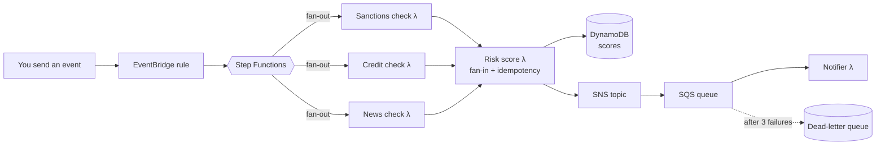

# Serverless Systems at Scale — Hands-on Workshop

**AWS SBG UB · Pre-Event Session 2 · 24 October 2026**

You will deploy a small **supplier risk monitoring** system on AWS and use it to see four production patterns working for real:

| Module | Pattern | You will see |
|---|---|---|
| 1 | **Fan-out / fan-in** | One event starts three checks *in parallel*, then their results are combined into one risk score |
| 2 | **Idempotency** | The same event sent twice creates only **one** score |
| 3 | **Failure handling** | A bad message is retried, parked in a **dead-letter queue (DLQ)**, then replayed after a fix |
| 4 | **Cold starts & cost** | How architecture (x86 vs arm64) and memory change start-up time and cost |

> **Time:** about 45 minutes. **Cost:** within the AWS Free Tier if you run the cleanup at the end.
> **Level:** beginner. You only copy and paste commands — no code editor or local installs needed.

---

## What you are building



- **EventBridge** receives "please check this supplier" events and routes them.
- **Step Functions** runs the three checks at the same time (**fan-out**) and waits for all of them before scoring (**fan-in**).
- **Lambda** functions do the work. The checks are mocked, so you don't need API keys.
- **DynamoDB** stores the scores, plus a record of requests already handled (for **idempotency**).
- **SNS → SQS** delivers alerts. Messages that keep failing go to the **dead-letter queue**.

> All suppliers and findings in this workshop are **fictional**.

---

## Module 0 — Set up (5 min)

### 0.1 Sign in and pick the region

1. Sign in to the [AWS Console](https://console.aws.amazon.com/).
2. In the top-right region menu, choose **Europe (Ireland) eu-west-1**.

### 0.2 Create a budget alarm (do this first!)

**Why:** a budget alarm emails you if anything starts costing money, so you never get a surprise bill.

1. Search for **Billing and Cost Management** → **Budgets** → **Create budget**.
2. Choose **Use a template** → **Zero spend budget** (or a **Monthly cost budget** of **$5**).
3. Enter your email address → **Create budget**.

### 0.3 Open CloudShell

Click the **CloudShell** icon (`>_`) in the top bar of the console. A terminal opens at the bottom of the page. It already has the AWS CLI, SAM CLI, Python and git installed, and it is signed in as you.

### 0.4 Get the code

Paste into CloudShell:

```bash
git clone https://github.com/tsekatm/serverless-at-scale-workshop.git
cd serverless-at-scale-workshop
```

✅ **Checkpoint:** `ls` shows `README.md`, `template.yaml`, `src`, `scripts`.

---

## Module 1 — Fan-out / fan-in (15 min)

### 1.1 Deploy

```bash
sam deploy
```

**What happens:** SAM reads `template.yaml` (your infrastructure as code) and creates every resource in the diagram above. This takes about 3–4 minutes. ☕

✅ **Checkpoint:** the last line says `Successfully created/updated stack - supplier-risk in eu-west-1`.

### 1.2 Send a supplier event

```bash
./scripts/send_event.sh SUP004
```

This asks the system to check **SUP004 – Highveld Electronics**.

### 1.3 Watch the fan-out

1. In the console, open **Step Functions** → **State machines** → the one starting with `SupplierRiskStateMachine`.
2. Click the latest execution → look at the **Graph view**.

You will see `SanctionsCheck`, `CreditCheck` and `NewsCheck` run **side by side** (fan-out). `CalculateRiskScore` only starts after all three finish (fan-in).

### 1.4 See the score

```bash
./scripts/show_scores.sh
```

✅ **Checkpoint:** you see `SUP004 | Highveld Electronics | ... | 63 | HIGH`.

**Try it:** check more suppliers (`SUP001` … `SUP010`) and compare the scores. Look in `src/suppliers.json` to see why each one scored the way it did.

> 💡 **Why fan-out?** The three checks don't depend on each other. Running them in parallel means the total time is the *slowest* check, not the *sum* of all three. If one check fails, Step Functions retries just that one.

---

## Module 2 — Idempotency (10 min)

Real systems deliver events **at least once**, which means sometimes **more than once** (network retries, a user double-clicking, a producer re-sending). Without protection you get duplicate scores and duplicate alerts.

### 2.1 Send the same request twice

Each request carries a `request_id`. Send the **same** one twice:

```bash
./scripts/send_event.sh SUP002 my-first-request
./scripts/send_event.sh SUP002 my-first-request
```

Wait ~10 seconds, then:

```bash
./scripts/show_executions.sh
./scripts/show_scores.sh
```

✅ **Checkpoint:** **two** Step Functions executions ran, but there is only **one** score row for `my-first-request`.

### 2.2 How it works

Open `src/risk_score.py`. The `@idempotent` decorator (from [Powertools for AWS Lambda](https://docs.powertools.aws.dev/lambda/python/latest/utilities/idempotency/)) builds a key from `supplier_id + request_id` and stores it in a DynamoDB table:

- **First time:** runs the function, saves the result.
- **Same key again:** skips the work and returns the saved result. No second score, no second alert.

See the records yourself: **DynamoDB** → **Tables** → `supplier-risk-IdempotencyTable-…` → **Explore table items**.

**Try it:** send `SUP002` with a *new* request id (`my-second-request`). Is a new score created? Why?

---

## Module 3 — Failure handling with a dead-letter queue (10 min)

Another (older) system still sends alerts in a **legacy format** (`supplierId` instead of `supplier_id`). Our notifier can't read it.

### 3.1 Send a message the notifier cannot handle

```bash
./scripts/send_legacy_alert.sh
./scripts/queue_status.sh
```

The notifier fails → SQS retries the message → after **3 failed attempts** it is moved to the **dead-letter queue**. Wait ~45 seconds and check again:

```bash
./scripts/queue_status.sh
```

✅ **Checkpoint:** `Dead-letter queue : 1 waiting`.

> 💡 **Why a DLQ?** Without one, a "poison" message would be retried forever, wasting money and blocking other messages. The DLQ parks it safely so you can investigate. Note that only the bad message failed: the notifier reports *partial batch failures*, so good messages in the same batch still succeed.

### 3.2 Find the cause

```bash
sam logs --stack-name supplier-risk --region eu-west-1 -n NotifierFunction -s '10mins ago'
```

Look for `KeyError: 'risk_level'`: the message used `riskLevel` (legacy) instead.

### 3.3 Fix the code

Open the notifier in the CloudShell editor:

```bash
nano src/notifier.py
```

Find the line that contains `MODULE 3 FIX` and delete the `# ` at the start, so it reads:

```python
    message = normalise_legacy(message)  # MODULE 3 FIX: remove the "# " at the start of this line
```

Save with **Ctrl+O**, **Enter**, then exit with **Ctrl+X**. Deploy the fix:

```bash
sam deploy
```

> Stuck? Copy the finished version: `cp solution/notifier.py src/notifier.py && sam deploy`

### 3.4 Replay the failed message (redrive)

```bash
./scripts/redrive_dlq.sh
```

Wait ~20 seconds:

```bash
./scripts/queue_status.sh
sam logs --stack-name supplier-risk --region eu-west-1 -n NotifierFunction -s '5mins ago' | grep ALERT
```

✅ **Checkpoint:** the DLQ is empty and you see `ALERT [MEDIUM] Karoo Packaging Co (SUP002) scored 47`.

You can also do the redrive in the console: **SQS** → `supplier-risk-AlertsDeadLetterQueue-…` → **Start DLQ redrive**.

---

## Module 4 — Cold starts and cost (stretch, if time allows)

A **cold start** happens when Lambda has to create a new environment for your function: download the code, start Python, and run everything outside the handler (the **init** phase). `src/coldstart.py` does real start-up work: it loads and indexes a 60,000-name watchlist.

The stack has the same function deployed three ways, changing **one thing at a time**:

| Function | Architecture | Memory |
|---|---|---|
| `ColdStartX86Mem512` | x86_64 | 512 MB |
| `ColdStartArmMem512` | **arm64** (Graviton) | 512 MB |
| `ColdStartArmMem1024` | arm64 | **1024 MB** |

### 4.1 Run the experiment

```bash
./scripts/coldstart_burst.sh
```

This calls each function 10 times **at once** (forcing 10 cold starts) and then 10 times one after another (warm). Wait ~30 seconds, then:

```bash
./scripts/coldstart_report.sh
```

### 4.2 Read the results

- **init ms**: average cold-start time.
- **billed ms**: average billed time per call. Since August 2025 the init phase is billed too, so cold starts cost money as well as time.
- **USD per 1M**: estimated cost of one million calls at this mix of cold and warm.

**Questions to discuss:**
1. What did switching **x86 → arm64** do to start-up time and cost?
2. What did doubling memory **512 → 1024 MB** do? Was it worth paying for?
3. Your results will differ slightly from your neighbour's. Why should you **measure** instead of guessing? (Tool: [AWS Lambda Power Tuning](https://github.com/alexcasalboni/aws-lambda-power-tuning).)

> 💡 **SnapStart** (shown in the demo) takes a snapshot of the function *after* init and restores it on cold start. It has extra charges, so it is left out of this lab.

---

## Cleanup (5 min) — don't skip!

```bash
sam delete --stack-name supplier-risk --region eu-west-1 --no-prompts
```

✅ **Checkpoint:** in **CloudFormation**, the `supplier-risk` stack is gone.

Optional: SAM also created a small stack named `aws-sam-cli-managed-default` that holds an S3 bucket for uploads. It costs almost nothing, but you can empty the bucket and delete that stack too.

---

## Supplier cheat sheet (all fictional)

| ID | Supplier | Why it's interesting |
|---|---|---|
| SUP001 | Ubuntu Foods | Clean — low risk |
| SUP002 | Karoo Packaging | Weak credit + business rescue news |
| SUP003 | Table Bay Logistics | Port closure news |
| SUP004 | Highveld Electronics | Possible sanctions match + strike |
| SUP007 | Cape Point Payments | Ransomware news |
| SUP010 | Northstar Trading | Confirmed sanctions match → always HIGH |

## Troubleshooting

| Problem | Fix |
|---|---|
| `Unable to locate credentials` | Close and reopen CloudShell |
| Stack fails with `ROLLBACK_COMPLETE` | `sam delete --stack-name supplier-risk --region eu-west-1 --no-prompts`, then `sam deploy` again |
| No score after sending an event | Open Step Functions and check whether the execution failed. Is the supplier id between `SUP001` and `SUP010`? |
| `Rate exceeded` / throttling in Module 4 | New accounts have low Lambda concurrency. Wait a minute and run it again |

## Run the tests (optional)

```bash
python3 -m venv .venv && source .venv/bin/activate
pip install -r requirements-dev.txt
pytest
```
